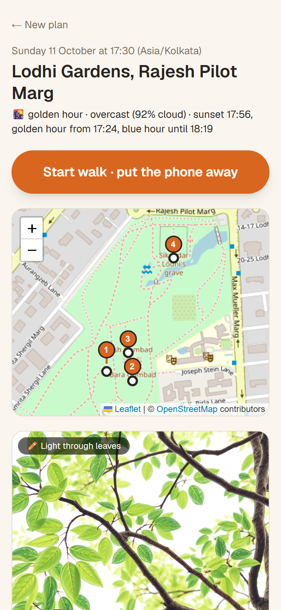
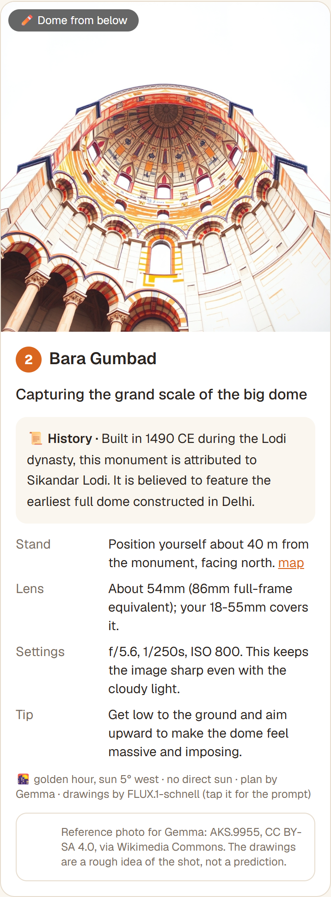
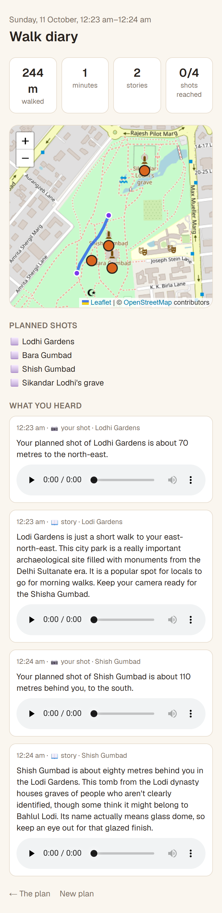

# LumiRoam

**A tour guide for photographers.** Most AI tour guides tell you about a building. LumiRoam tells you
how and when to photograph it: where to stand, which way to face, which focal length for *your*
camera and lenses, and starting settings for that light. It also gives you a little history, and a
crayon sketch of the shot to aim for. Then the phone goes in your pocket, and it talks in your ear
while you walk.

Built for DEV's [Hacktoberfest Open-Source AI Challenge, Week 1: Touch Grass](https://dev.to/challenges/hacktoberfest-week1-2026-10-05).

- **Live app:** [lumiroam.onrender.com](https://lumiroam.onrender.com/) (free tier: if it's been asleep,
  the first load takes about half a minute)
- **Demo video:** [youtu.be/-LOx5g-9_Go](https://youtu.be/-LOx5g-9_Go)
- **How it works, end to end:** [docs/how-it-works-script.md](docs/how-it-works-script.md)
- **Build log** (what worked, what broke, what surprised us): [BUILD_LOG.md](BUILD_LOG.md)

<p>
  
  
  
</p>

## What it does

**Plan mode (about a minute on screen).** Type a place, the local time you'll be there, your camera
and your lenses. LumiRoam picks **four photogenic stops** within a short walk, 800 m by default. For
each one you get:

- **Where to stand.** Often the spot where a Wikimedia Commons photographer actually stood.
- **Which way to face**, and whether the subject will be front-, side- or back-lit.
- **Focal length for your body and lenses**: "About 34mm on your 18-55", or "wider than your 18mm,
  step back 13 m".
- **Starting settings** from the light phase and the cloud forecast.
- **A short history**, retold by Gemma from the Wikipedia article only.
- **One crayon drawing** of the shot to aim for. Gemma looks at a real photo and writes the prompt;
  FLUX.1 [schnell] draws it.

**Walk mode (phone in pocket).** Tap Start, then Pocket mode. Every 75 m or 3 minutes you hear, in your
earbuds:

- how far your next planned shot is, and in which direction
- once you're there: a little history, which way to face, your lens, your settings and a tip
- short stories about documented places you're walking past, from Wikipedia only

**Walk diary.** Afterwards you get the route you walked, distance and time, every story with its
audio, and which planned shots you reached.

## How it works

The rule that shapes everything: **code computes, Gemma explains.** The sun position, where to stand,
focal length and exposure are all calculated, never guessed by the model.

```
plan:  locate → find spots → write plans → fallback sketch → save          (Mastra workflow)
walk:  every 75 m / 3 min → $geoNear planned shot + $geoNear unheard place
       → Gemma retells Wikipedia → ElevenLabs speaks it                    (Mastra agent + MongoDB)
```

| Part | What it does | Code |
|---|---|---|
| Locate | Nominatim geocoding (prefers areas such as parks), offline time zone, weather from Open-Meteo with MET Norway as fallback | [nominatim.ts](src/lib/sources/nominatim.ts), [openmeteo.ts](src/lib/sources/openmeteo.ts) |
| Find spots | OpenStreetMap via Overpass, plus Wikipedia geosearch and 30-day page views for ranking; Commons photos that know where the camera stood | [spots.ts](src/lib/spots.ts), [commons.ts](src/lib/sources/commons.ts) |
| Light and geometry | suncalc for the sun; stand point, facing, light angle, focal length for your crop factor, sunny-16 exposure | [light.ts](src/lib/light.ts), [plan-text.ts](src/lib/plan-text.ts), [camera.ts](src/lib/camera.ts) |
| Write plans | One Gemma 4 call sees all four Commons photos and fact sheets; returns the plan, history and one drawing prompt per stop | [plan-shoot.ts](src/mastra/workflows/plan-shoot.ts), [planner.ts](src/mastra/agents/planner.ts) |
| Drawings | FLUX.1 [schnell] draws each prompt on first view, cached forever in GridFS | [t2i.ts](src/lib/t2i.ts), [api/sketch](src/app/api/sketch/route.ts) |
| Walk tick | Two `$geoNear` queries, Gemma retelling grounded in Wikipedia, speech-friendly text, ElevenLabs clips | [walk-tick.ts](src/mastra/walk-tick.ts), [walk.ts](src/lib/walk.ts), [voice.ts](src/lib/voice.ts) |

### Stack

- **Language + vision:** Gemma 4 26B-A4B, with Gemma 3 12B as fallback, on Cloudflare Workers AI. It
  works with any OpenAI-compatible host: Hugging Face router, OpenRouter, Ollama or vLLM.
- **Drawings:** FLUX.1 [schnell] (Apache-2.0) on Cloudflare Workers AI, or a Hugging Face ZeroGPU Space.
- **Agent framework:** [Mastra](https://mastra.ai), for the workflow, agents, tools and model fallback.
- **Database:** MongoDB Atlas. It provides 2dsphere indexes with `$geoNear`, GridFS for drawings and
  voice clips (keyed by what produced them, so nothing is generated twice), a time-series collection
  for walk routes, and TTL caching for the free APIs.
- **Voice:** ElevenLabs `eleven_v4`, falling back to the browser's own speech synthesis.
- **App:** Next.js 16, TypeScript, Leaflet + OpenStreetMap tiles; hosted on Render.
- **Open data:** OpenStreetMap, Wikipedia, Wikimedia Commons, Open-Meteo, MET Norway.

## Run it yourself

Requirements: Node 22+, and a free MongoDB Atlas cluster for saving shoots and for walk mode.

```bash
git clone https://github.com/stealth-raptor/LumiRoam.git
cd LumiRoam
npm install
cp .env.example .env.local   # then fill it in, see below
npm run dev                  # http://localhost:3000
```

Every key is optional, and the app gets better with each one:

| Variable | Without it |
|---|---|
| `MONGODB_URI`, `MONGODB_DB` | Plans still work but aren't saved; no walk mode, drawings or diary |
| `LLM_BASE_URL`, `LLM_API_KEY` (or `HF_TOKEN`), `LLM_MODEL`, `LLM_FALLBACK_MODEL` | Plans and stories come from templates built from the same facts |
| `LLM_EXTRA_BODY` | Defaults to switching off Gemma 4's "thinking" phase. Set `{}` for hosts that reject unknown fields |
| `T2I_PROVIDER`, `CLOUDFLARE_ACCOUNT_ID`, `CLOUDFLARE_API_TOKEN` | Stops show a free sketch drawn from geometry instead |
| `ELEVENLABS_API_KEY`, `ELEVENLABS_VOICE_ID`, `ELEVENLABS_MODEL` | The phone's built-in voice reads the walk |
| `LUMIROAM_USER_AGENT` | A default identifying LumiRoam is sent to OSM and Wikimedia |

Example for Cloudflare Workers AI's free tier, which covers both Gemma and FLUX:

```bash
LLM_BASE_URL=https://api.cloudflare.com/client/v4/accounts/<account-id>/ai/v1
LLM_API_KEY=<cloudflare-api-token>
LLM_MODEL=@cf/google/gemma-4-26b-a4b-it
LLM_FALLBACK_MODEL=@cf/google/gemma-3-12b-it
T2I_PROVIDER=cloudflare
CLOUDFLARE_ACCOUNT_ID=<account-id>
CLOUDFLARE_API_TOKEN=<cloudflare-api-token>
```

**Deploying to a host without a fixed outbound IP** (such as Render's free tier): allow `0.0.0.0/0`
under Atlas → Network Access. Otherwise Atlas drops the connection with a confusing
`SSL alert number 80`.

**Testing walk mode at a desk:** tick "Simulate" on the walk page, then tap the map to move.

## Known limitations

- When no Commons photo records a camera position, the computed stand point can land somewhere you
  can't stand, such as in a river.
- Phone browsers pause GPS when the screen locks, so walk mode keeps the screen on, behind a black
  "pocket mode" overlay. Real background GPS would need a native app.
- Free tiers have daily limits: Cloudflare neurons, Open-Meteo per IP. Everything that can be cached
  is cached in MongoDB.

## Credits

Map data © [OpenStreetMap](https://www.openstreetmap.org/copyright) contributors (ODbL). Text from
Wikipedia (CC BY-SA). Reference photos from Wikimedia Commons, credited to each photographer in the
app. Sun positions by [suncalc](https://github.com/mourner/suncalc). Weather by
[Open-Meteo](https://open-meteo.com) and [MET Norway](https://api.met.no).

Built with [Claude Code](https://claude.com/claude-code), using the official Mastra, MongoDB and
ElevenLabs agent skills.
